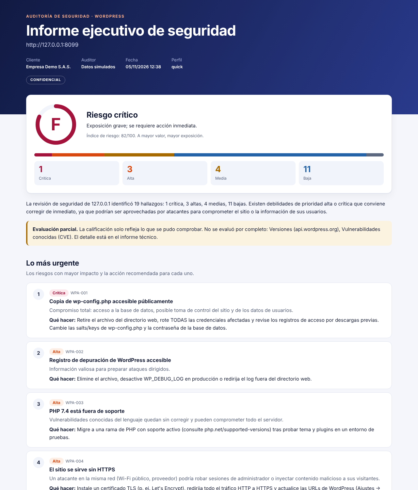

# wpaudit

**Audita tu WordPress sin atacarlo y recibe un informe que Gerencia entiende y TI puede ejecutar.**

*Non-intrusive WordPress security audit for Kali Linux with executive and technical reports (reports in Spanish).*

```bash
git clone https://github.com/juanmanuelcaicedo/wpaudit.git && cd wpaudit
bash install.sh
wpaudit https://misitio.com --authorized --client "Mi Empresa" --auditor "Tu Nombre"
```

> [!WARNING]
> Úsala solo en sitios **propios** o con **autorización escrita**. Auditar sistemas ajenos sin permiso puede ser un delito.

## Qué obtienes

| Archivo | Para qué sirve |
|---|---|
| `informe_ejecutivo.html/.pdf` | Nota de la A a la F, riesgos de negocio, aspectos positivos y plan a 7, 30 y 90 días |
| `informe_tecnico.html/.pdf` | Hallazgos con evidencia, corrección sugerida, referencias y cobertura de la auditoría |
| `resultados.json` | Datos completos para integraciones y para comparar auditorías |
| `hallazgos.csv` | Seguimiento en Excel o Jira |
| `raw/` | Salida de las herramientas externas |



Mira un resultado de ejemplo, con datos simulados: informe ejecutivo ([HTML](docs/demo/informe_ejecutivo.html), [PDF](docs/demo/informe_ejecutivo.pdf)) e informe técnico ([HTML](docs/demo/informe_tecnico.html), [PDF](docs/demo/informe_tecnico.pdf)). Descarga los HTML y ábrelos en tu navegador.

## Elige un perfil

| Perfil | Ejecuta | Úsalo para |
|---|---|---|
| `quick` | Motor propio | Una revisión rápida, sin herramientas externas |
| `standard` (por defecto) | + WhatWeb, SSLScan y WPScan | La auditoría habitual |
| `full` | + Nmap y Nikto | Una revisión completa; avisa antes a tu hosting |

## Configura tu token de WPScan

El repositorio no incluye ningún token: cada persona usa el suyo. Es opcional, pero sin él los informes dejan constancia de que las vulnerabilidades conocidas de plugins y temas **no se evaluaron**.

1. Crea una cuenta en [wpscan.com](https://wpscan.com) y copia tu token desde tu [perfil](https://wpscan.com/profile). Revisa allí los límites de tu plan.
2. Guárdalo en un archivo privado de tu equipo. El token no se muestra mientras lo escribes:

   ```bash
   install -m 600 /dev/null ~/.wpaudit.env
   printf 'Token de WPScan: '; read -rs T; echo
   printf "export WPSCAN_API_TOKEN='%s'\n" "$T" > ~/.wpaudit.env; unset T
   ```

3. Cárgalo en cada sesión antes de auditar:

   ```bash
   source ~/.wpaudit.env
   wpaudit https://misitio.com --authorized
   ```

wpaudit lo toma de la variable `WPSCAN_API_TOKEN` y lo oculta en sus registros. Evita pasarlo con `--wpscan-token`, porque queda en el historial de la terminal. Nunca lo subas a un repositorio; si se filtra, revócalo y genera otro desde tu perfil de WPScan.

## Mide tu avance

```bash
wpaudit https://misitio.com --authorized --compare reports/misitio.com_20261105-1000/resultados.json
```

El informe muestra lo corregido, lo nuevo y lo pendiente.

Para usarla en CI, `--fail-on high` termina con código 3 si hay hallazgos altos o críticos.

## Qué revisa

- **Transporte:** HTTPS, redirección, certificado, TLS obsoleto y contenido mixto.
- **Cabeceras y cookies:** HSTS, CSP, X-Frame-Options, atributos de cookies, CORS y métodos HTTP.
- **WordPress:** versión del núcleo, plugins y temas desactualizados o abandonados.
- **Acceso:** enumeración de usuarios, XML-RPC, login y registro abierto.
- **Archivos expuestos:** copias de `wp-config`, `.env`, `.git`, `debug.log`, respaldos, phpinfo y listados de directorios, validados por su contenido.

## Qué no hace

No hace fuerza bruta, no prueba contraseñas, no explota vulnerabilidades, no inyecta payloads, no inicia sesión y no modifica nada. Tampoco sigue redirecciones fuera del dominio autorizado.

No reemplaza una prueba de penetración ni la revisión de tu código a medida.

## Cómo se calcula la nota

El índice suma crítica 25, alta 10, media 4 y baja 1, hasta un máximo de 100: A ≤ 3, B ≤ 10, C ≤ 24, D ≤ 49 y F > 49. Un hallazgo crítico siempre da F y uno alto, como mínimo, D.

Es un indicador para priorizar y medir tu avance, no una certificación.

## Uso responsable de los informes

Los informes describen debilidades reales: guárdalos con cuidado y no los subas a repositorios ni a issues públicos.

## Otras formas de instalar

```bash
pipx install .                     # en cualquier Linux
bash install.sh --minimal            # sin herramientas externas
python3 -m wpaudit --help          # sin instalar, si ya tienes requests y jinja2
```

## Contribuir

Lee la [guía de contribución](CONTRIBUTING.md). Para reportar un fallo de seguridad, sigue la [política de seguridad](SECURITY.md).

## Licencia

[MIT](LICENSE). Creado por [Juan Manuel Caicedo Castaño](https://www.linkedin.com/in/juancaicedoc/).
