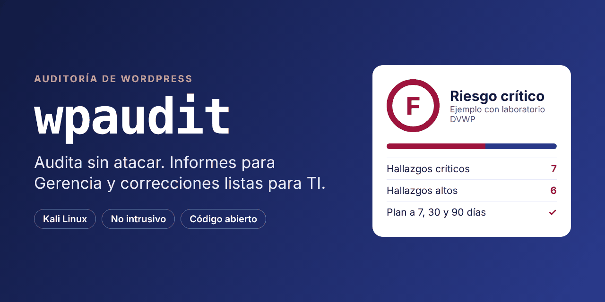
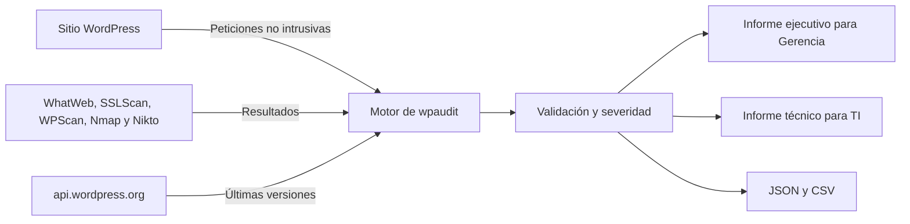
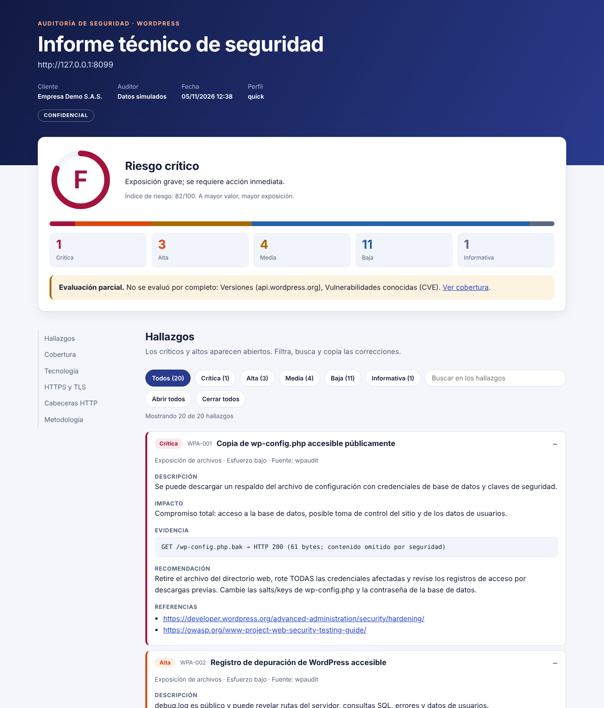

<div align="center">



# wpaudit

**Audita tu WordPress sin atacarlo y convierte los hallazgos en un informe que Gerencia entiende y TI puede ejecutar.**

*Non-intrusive WordPress security audit for Kali Linux with executive and technical reports (reports in Spanish).*

[](https://github.com/juanmanuelcaicedo/wpaudit/actions/workflows/ci.yml)
[](https://github.com/juanmanuelcaicedo/wpaudit/releases)
[](pyproject.toml)
[](#-probado-en-un-laboratorio)
[](#-qué-no-hace)
[](LICENSE)

[Inicio rápido](#-inicio-rápido) · [Cómo funciona](#-cómo-funciona) · [El informe](#-el-informe) · [Qué revisa](#-qué-revisa) · [Hoja de ruta](#️-hoja-de-ruta) · [Contribuir](#-contribuir)

</div>

---

## El problema

Un escáner puede devolver decenas de vulnerabilidades, pero eso no le dice a Gerencia cuánto riesgo existe ni a TI qué corregir primero. Pasar de esa salida técnica a un plan de trabajo suele ser manual.

**wpaudit** resuelve ambas partes: revisa el sitio con pruebas no intrusivas, reúne los resultados de varias herramientas y los convierte en un plan priorizado.

| En cifras | |
|---|---|
| **43** comprobaciones propias | sobre transporte, cabeceras, acceso y archivos expuestos |
| **5** herramientas integradas | WhatWeb, SSLScan, WPScan, Nmap y Nikto |
| **3** plazos de acción | 7, 30 y 90 días, según el riesgo |
| **0** cambios en el sitio | sin fuerza bruta, explotación ni inicio de sesión |

## ✨ Características

- **No intrusivo:** no prueba contraseñas, no explota fallos y no modifica contenido.
- **Dos informes:** uno para decidir y otro para corregir, en HTML y PDF.
- **Priorización:** nota de la A a la F, índice de riesgo de 0 a 100 y plan por plazos.
- **Vulnerabilidades agrupadas:** con WPScan, resume por componente lo que antes eran decenas de líneas.
- **Menos falsos positivos:** valida los archivos expuestos por su contenido, no solo por el código HTTP.
- **Cobertura honesta:** lo que no se pudo comprobar se declara y nunca cuenta como aprobado.
- **Medición del avance:** compara dos auditorías y muestra lo corregido, lo nuevo y lo pendiente.
- **Listo para CI:** `--fail-on high` termina con código 3 si hay hallazgos altos o críticos.

> [!WARNING]
> Úsalo solo en sitios **propios** o con **autorización escrita**. Auditar sistemas ajenos sin permiso puede ser un delito.

## 🚀 Inicio rápido

### 1. Instala

En Kali Linux o Debian. El instalador solo agrega lo que falta y no actualiza tus demás paquetes:

```bash
git clone https://github.com/juanmanuelcaicedo/wpaudit.git && cd wpaudit
bash install.sh
```

### 2. Audita

```bash
wpaudit https://misitio.com --authorized --client "Mi Empresa" --auditor "Tu Nombre"
```

Los informes quedan en `reports/`. Si quieres probarlo sin un sitio real, usa el [laboratorio DVWP](#-probado-en-un-laboratorio).

### Perfiles

| Perfil | Ejecuta | Úsalo para |
|---|---|---|
| `quick` | Motor propio | Una revisión rápida, sin herramientas externas |
| `standard` (por defecto) | + WhatWeb, SSLScan y WPScan | La auditoría habitual |
| `full` | + Nmap y Nikto | Una revisión completa; avisa antes a tu hosting |

### Parámetros

| Parámetro | Por defecto | Descripción |
|---|---|---|
| `--authorized` | — | Confirma que tienes autorización para auditar el sitio. |
| `--profile` | `standard` | Elige `quick`, `standard` o `full`. |
| `--client`, `--auditor` | — | Nombres que aparecen en los informes. |
| `-o`, `--output` | `reports` | Carpeta de salida. |
| `--tools` | — | Herramientas externas, separadas por comas. Reemplaza las del perfil. |
| `--compare` | — | `resultados.json` de una auditoría anterior. |
| `--fail-on` | — | Termina con código 3 desde la severidad indicada. |
| `--no-pdf` | — | No genera los PDF. |
| `--crawl` | `6` | Páginas internas que rastrea. |
| `--delay` | `0.25` | Segundos entre peticiones. |

Consulta todas las opciones con `wpaudit --help`.

<details>
<summary><b>Configura tu token de WPScan</b> (opcional)</summary>
<br>

El repositorio no incluye ningún token: cada persona usa el suyo. Sin él, los informes dejan constancia de que las vulnerabilidades conocidas de plugins y temas **no se evaluaron**.

1. Crea una cuenta en [wpscan.com](https://wpscan.com) y copia tu token desde tu [perfil](https://wpscan.com/profile). Revisa allí los límites de tu plan.
2. Pide el token en una línea aparte. Pégala sola, pulsa Enter, pega el token y pulsa Enter otra vez; no se mostrará:

   ```bash
   printf 'Token de WPScan: '; read -rs T; echo
   ```

3. Guárdalo en un archivo privado de tu equipo:

   ```bash
   install -m 600 /dev/null ~/.wpaudit.env
   printf "export WPSCAN_API_TOKEN='%s'\n" "$T" > ~/.wpaudit.env; unset T
   ```

4. Cárgalo en cada sesión antes de auditar:

   ```bash
   source ~/.wpaudit.env
   wpaudit https://misitio.com --authorized
   ```

wpaudit lo toma de la variable `WPSCAN_API_TOKEN` y lo oculta en sus registros. Evita pasarlo con `--wpscan-token`, porque queda en el historial de la terminal. Si se filtra, revócalo y genera otro desde tu perfil de WPScan.

</details>

<details>
<summary><b>Otras formas de instalar</b></summary>
<br>

```bash
pipx install .             # en cualquier Linux
bash install.sh --minimal  # sin herramientas externas
python3 -m wpaudit --help  # sin instalar, si ya tienes requests y jinja2
```

</details>

## 🔄 Cómo funciona



## 📸 El informe


<details>
<summary><b>Ver el informe técnico</b></summary>
<br>

</details>

> [!TIP]
> Descarga un ejemplo con datos simulados y ábrelo en tu navegador: informe ejecutivo ([HTML](docs/demo/informe_ejecutivo.html), [PDF](docs/demo/informe_ejecutivo.pdf)) e informe técnico ([HTML](docs/demo/informe_tecnico.html), [PDF](docs/demo/informe_tecnico.pdf)).

| Público | Qué recibe |
|---|---|
| **Gerencia** | Nota de riesgo, riesgos urgentes en lenguaje de negocio y plan a 7, 30 y 90 días. |
| **Equipo de TI** | Hallazgos con evidencia, filtros, búsqueda, correcciones para copiar y referencias. |

Los informes funcionan sin conexión, se adaptan al celular y tienen modo oscuro.

## 🧪 Probado en un laboratorio

Lo probé en Kali Linux contra [DVWP](https://github.com/vavkamil/dvwp), un WordPress vulnerable a propósito que corre en tu propio equipo:

| Resultado | |
|---|---|
| **WordPress y plugins** | Detectó WordPress 5.3 y los plugins vulnerables con su versión, incluidos los que no aparecen en el HTML público. |
| **142 → 7** | Con un token de WPScan, agrupó 142 vulnerabilidades conocidas en 7 hallazgos priorizados. |
| **Herramientas** | Ejecutó WhatWeb, WPScan, Nmap y Nikto, y generó informes HTML, PDF, JSON y CSV. |
| **Pendiente** | SSLScan y el análisis de TLS aún no se han probado en un sitio HTTPS real. |

Para repetir la prueba, sigue la [guía de DVWP](https://github.com/vavkamil/dvwp) y ejecuta:

```bash
wpaudit http://127.0.0.1:31337 --authorized --profile standard
```

> [!CAUTION]
> DVWP es vulnerable a propósito. **No lo expongas a internet** y apágalo al terminar.

## 🧩 Qué revisa

<details open>
<summary><b>Transporte y TLS</b></summary>

- Uso de HTTPS, redirección y contenido mixto.
- Certificado inválido o próximo a vencer.
- Protocolos TLS obsoletos, cifrados débiles y Heartbleed, con SSLScan.
</details>

<details>
<summary><b>Cabeceras, cookies y CORS</b></summary>

- HSTS, CSP, X-Frame-Options y otras cabeceras de seguridad.
- Atributos `Secure`, `HttpOnly` y `SameSite` de las cookies.
- Orígenes reflejados en CORS y métodos HTTP innecesarios.
- Divulgación de versiones del servidor.
</details>

<details>
<summary><b>WordPress, plugins y temas</b></summary>

- Núcleo, plugins y temas desactualizados o abandonados.
- Versión de PHP fuera de soporte.
- Plugins visibles en el sitio y una lista de plugins comunes que no siempre aparecen en el HTML.
- Vulnerabilidades conocidas, con token de WPScan.
</details>

<details>
<summary><b>Acceso y usuarios</b></summary>

- Enumeración de usuarios y nombres predecibles.
- XML-RPC, panel de acceso y registro abierto.
</details>

<details>
<summary><b>Archivos expuestos</b></summary>

- Copias de `wp-config`, `.env`, `.git`, `.htaccess` y `composer`.
- `debug.log`, registros de errores, respaldos y volcados de base de datos.
- `phpinfo`, phpMyAdmin, Adminer y páginas de estado del servidor.
- Listados de directorios.
</details>

<details>
<summary><b>Red y servidor</b></summary>

- Puertos expuestos, con Nmap.
- Observaciones de configuración, con Nikto.
- Scripts de terceros sin SRI, `wp-cron.php` y ausencia de `security.txt`.
</details>

## 📁 Qué genera

```text
reports/misitio.com_20261105-1000/
├── informe_ejecutivo.html/.pdf  # nota, riesgos y plan de acción
├── informe_tecnico.html/.pdf    # evidencia, correcciones y cobertura
├── resultados.json              # datos completos y comparaciones
├── hallazgos.csv                # seguimiento en Excel o Jira
└── raw/                         # salida de las herramientas externas
```

## 📐 Severidad y nota

| Severidad | Puntos | Plazo sugerido |
|---|---|---|
| **Crítica** | 25 | 0 a 7 días |
| **Alta** | 10 | 0 a 7 días |
| **Media** | 4 | Hasta 30 días |
| **Baja** | 1 | Hasta 90 días |

El índice suma esos puntos hasta un máximo de 100: A ≤ 3, B ≤ 10, C ≤ 24, D ≤ 49 y F > 49. Un hallazgo crítico siempre da F y uno alto, como mínimo, D.

Cuando una vulnerabilidad no trae CVSS, wpaudit estima su gravedad por el título y lo indica en el informe. La nota sirve para priorizar y medir tu avance; no es una certificación.

Para ver tu evolución, compara con la auditoría anterior:

```bash
wpaudit https://misitio.com --authorized --compare reports/misitio.com_20261105-1000/resultados.json
```

## 🚫 Qué no hace

No hace fuerza bruta, no prueba contraseñas, no explota vulnerabilidades, no inyecta payloads, no inicia sesión y no modifica nada. Tampoco sigue redirecciones fuera del dominio autorizado.

## ⚠️ Uso responsable

> [!CAUTION]
> Los informes describen debilidades reales de un sitio. Guárdalos de forma segura y **nunca los subas a un issue ni a un repositorio público**.

**Alcance:** wpaudit revisa la exposición externa. No reemplaza una prueba de penetración, la revisión de tu código a medida ni el criterio de un especialista. La ausencia de hallazgos no garantiza la ausencia de vulnerabilidades.

## 🗺️ Hoja de ruta

- [ ] Validar SSLScan y el análisis de TLS en sitios HTTPS reales.
- [ ] Publicar los informes en inglés.
- [ ] Ampliar la lista de plugins detectados.
- [ ] Publicar una imagen de Docker.

¿Tienes una idea? [Abre un issue](../../issues/new).

## 🤝 Contribuir

Lee la [guía de contribución](CONTRIBUTING.md) para añadir una comprobación. Para reportar un fallo de seguridad en wpaudit, sigue la [política de seguridad](SECURITY.md).

## 📄 Licencia

Distribuido bajo la [licencia MIT](LICENSE).

## 👤 Autor

**Juan Manuel Caicedo Castaño**, Especialista en Ciberseguridad

[LinkedIn](https://www.linkedin.com/in/juancaicedoc/) · [GitHub](https://github.com/juanmanuelcaicedo)

Si te resulta útil, deja una ⭐ para que más equipos lo encuentren.
